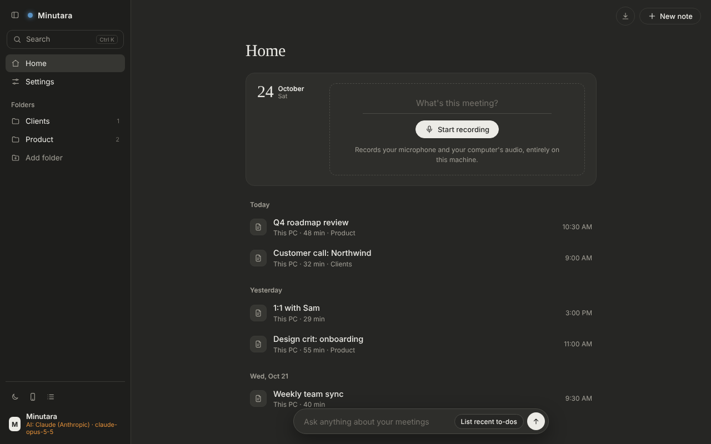
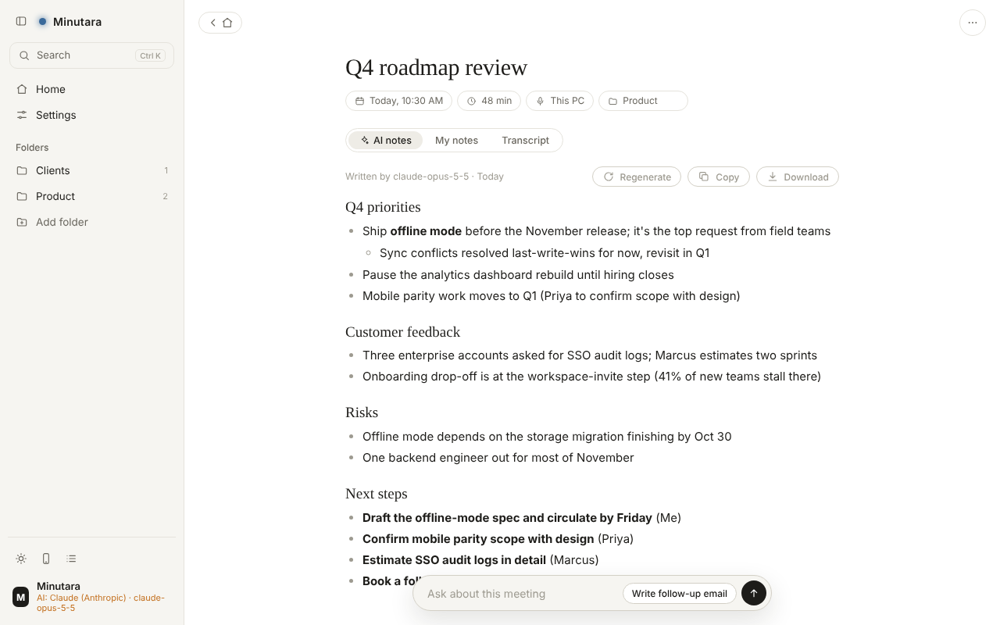
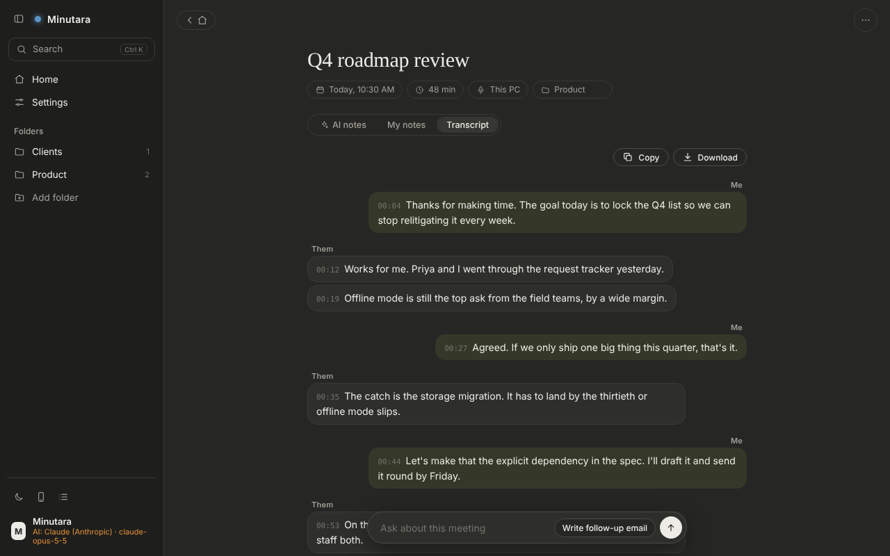
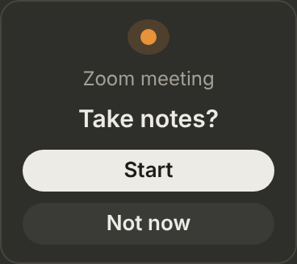
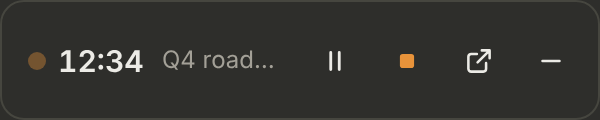
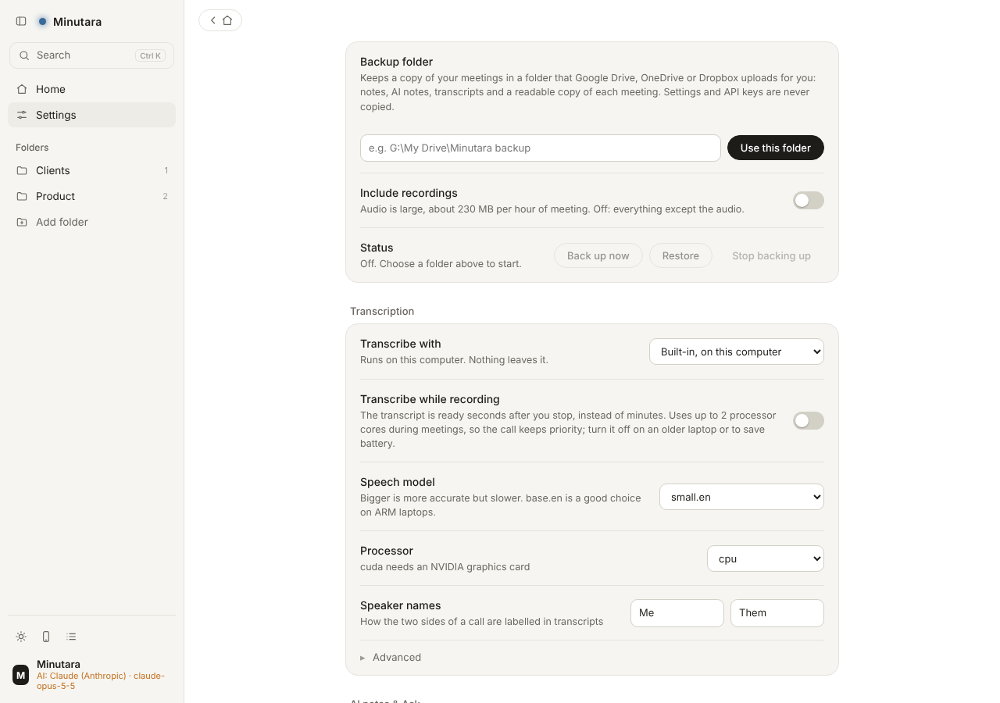

# Minutara

**Private meeting notes for Windows.** Minutara records your Zoom, Teams and
Meet calls, transcribes them on your own PC, and writes AI notes, with no bot
joining the call and no subscription. Nothing leaves your computer unless you
switch it on.



- **No bot, no cloud by default.** It records what your speakers play and your
  microphone, right on your PC. Nobody in the meeting is notified (so do tell
  them; see [Consent](#consent)).
- **Knows who said what.** Your microphone and the call audio are recorded on
  separate channels, so the transcript says *Me* and *Them* from the wiring,
  not from a model guessing.
- **Fast, local transcription** with Whisper, optionally *while* the meeting
  runs so the transcript is ready seconds after you stop. Or use Groq, OpenAI
  or your own transcription server.
- **AI notes and Ask**, Granola-style, with the provider you choose: Claude,
  OpenAI, Gemini, any OpenAI-compatible server, or Ollama running locally.
- **Spots your meetings.** When Zoom, Teams or Webex (app or browser) takes the
  microphone, a small pop-up offers to start; while recording, a floating
  recorder stays on top.
- **Your data stays yours.** Plain files on your disk; export any meeting as
  text or Markdown; keep a readable copy of every meeting in a folder; back
  everything up to Google Drive, OneDrive or Dropbox.
- **Bring your history.** Import your meetings from Granola, and recordings
  from a Pocket device.

| AI notes | Transcript | Floating recorder |
|---|---|---|
|  |  | <br> |

> Minutara is an independent open-source project. It isn't affiliated with,
> endorsed by or connected to Granola, Zoom, Microsoft, Google or Pocket;
> their names are used only to say what Minutara works with.

## Download the app (easiest)

Grab **Minutara-windows.zip** from the [latest release](https://github.com/nexusforce/minutara/releases/latest),
extract it somewhere permanent (or onto a USB stick) and double-click
**Minutara.exe**. No Python needed. It's built automatically on every merge
to `main`, and each build is tested on Windows before it's published.

- The first time, Windows says "Windows protected your PC" (the app isn't
  code-signed): click **More info → Run anyway**. Unblocking the zip first
  (right-click → Properties → Unblock) avoids it.
- Your settings, notes and recordings live next to Minutara.exe, in plain
  folders (`notes`, `transcripts`, `recordings`).

**Updating (or going back a version).** Quit Minutara, delete `Minutara.exe`,
`minutara-cli.exe` and the `_internal` folder, then extract the zip of the
version you want into the folder that *contains* your Minutara folder. Your
data folders and `config.json` aren't in the zip, so they're never touched.

**Coming from "Scribe"** (this app's earlier name, up to 1.0.21): rename your
`Scribe` folder to `Minutara`, delete `Scribe.exe`, `scribe-cli.exe` and
`_internal` in it, then extract the new zip next to it as above. Everything
carries over; re-pin the new Minutara.exe to the taskbar.
- `minutara-cli.exe` in the same folder is the command-line version
  (`minutara-cli doctor` checks that every part Minutara needs works).
- It's an x64 app; ARM laptops run it through Windows' built-in emulation.
- Minutara unblocks its own window files if Windows marked them as
  downloaded; if it ever opens in an Edge window instead (no floating
  recorder), Settings → Meetings says why, and so does `minutara-cli doctor`.
- Minutara opens in its own window, drawn by WebView2 (the web engine built
  into Windows 10/11), so the taskbar button and a pinned icon are Minutara's.
  It isn't a website: the window talks only to Minutara running on your PC.
  Closing the window quits Minutara; a recording in progress is stopped and
  saved first, and a transcription under way finishes in the background.

To build the .exe yourself: `powershell -ExecutionPolicy Bypass -File build\build_exe.ps1`.

## Quick start (from a clone)

```powershell
git clone https://github.com/nexusforce/minutara
cd minutara
python -m venv .venv
.venv\Scripts\pip install -r requirements.txt
copy config.example.json config.json
```

Then **double-click `Minutara App.bat`** — the app opens in its own window.
The engine runs windowless in the background and logs to `minutara.log`; quit
it from Settings → Quit. If you want a visible console instead, run
`minutara.bat serve --open`.

The same things are available as commands, if you prefer a terminal:

```powershell
minutara.bat record --title "Board sync"    # capture a Zoom/Teams call, Ctrl+C to stop
minutara.bat from-usb                       # pull new recordings off the Pocket
minutara.bat serve                          # the GUI server (add --open to pop the window)
minutara.bat config                         # show toggles and whether the drive is connected
```

First transcription downloads the Whisper model (~500 MB for `small.en`).

On a **Snapdragon / ARM64** laptop, install the **x64** build of Python from
python.org (the "Windows installer (64-bit)"), *not* the ARM64 build — the
capture and transcription wheels are x64-only and Windows 11 runs them under
emulation. See [Windows on ARM](#windows-on-arm-snapdragon-laptops) below.

## Portable build (run from a USB stick)

```powershell
powershell -ExecutionPolicy Bypass -File build\make_portable.ps1 -Target E:\Minutara
```

Run once on a machine with internet; the stick works offline afterward. It
bundles embeddable Python, all dependencies, the app, and a pre-baked Whisper
model (~2 GB total). Nothing is installed on the host, no admin needed, and
all data — recordings, transcripts, config — stays on the stick.

Realities of stick life: use USB 3.0 (the model is read on every run),
SmartScreen may grumble at an unsigned interpreter on removable media, and a
locked-down work laptop with application allowlisting may refuse to run it at
all.

## Windows on ARM (Snapdragon laptops)

Use **x64 Python under emulation** — don't try a native ARM64 install. Two
load-bearing dependencies, `PyAudioWPatch` (WASAPI capture) and `ctranslate2`
(faster-whisper's engine), publish no `win_arm64` wheels, so a native ARM64
Python cannot record or transcribe. Windows 11 on ARM runs x64 Python
transparently through the Prism emulator, so both install paths work:

- **Installed clone:** grab the *x64* Python from python.org (the "Windows
  installer (64-bit)", not the ARM64 one), then follow
  [Quick start](#quick-start-from-a-clone) unchanged.
- **Portable stick:** the build script already fetches x64 embeddable Python,
  so it works as-is — even when run on the ARM machine itself:

  ```powershell
  powershell -ExecutionPolicy Bypass -File build\make_portable.ps1 -Target E:\Minutara
  ```

Notes for ARM:

- **Windows 11 is required** (its x64 emulation covers everything here);
  24H2 or later is noticeably faster because Prism adds AVX/AVX2 support,
  which faster-whisper uses heavily.
- **Transcription pays an emulation tax.** If `small.en` feels slow, build
  with `-Model base.en` (or set `"whisper_model": "base.en"` in config.json)
  and step back up if quality allows.
- Recording and the phone remote are I/O-bound and run fine under emulation.

## The app

Laid out like Granola: every meeting is a **note**. The sidebar has search
(Ctrl+K, covers titles, your notes and transcripts), Home, and your folders.
Home shows today's date and a **Start recording** card, then your meetings
grouped by day, each labelled when it's still recording, transcribing, or
not transcribed yet. **New note** (top right) starts recording straight
away; the ↓ button pulls new recordings off your Pocket.

A note has a title, chips for date, length, source and folder, and three tabs:

- **AI notes** — Granola-style "enhanced" notes: topics, decisions and next
  steps written from the transcript and your rough notes (see below).
- **My notes** — type while the meeting runs; it saves as you go.
- **Transcript** — drawn as a conversation, you on the right and them on
  the left (the stereo recording knows who said what). Click any timestamp
  to play the recording from that moment.

The pill at the bottom works like Granola's: pause, resume and stop while
recording, then a player once the audio is saved. The **…** menu downloads
or copies the whole meeting, downloads the recording, re-runs
transcription, or deletes the note.

Capture and transcription are separate steps. Audio streams to disk while
you record — a crash loses seconds, not the meeting — and the note has its
recording the moment you press Stop, whether or not it's ever transcribed.
By default transcription starts automatically (the lamp breathes blue);
turn that off in Settings and press **Transcribe** on the note when you're
ready. You can start the next recording while the last one transcribes.

**Settings** is a single preferences page: auto-transcribe, theme
(System/Light/Dark), microphone, recordings folder, speech model, speaker
names, the Pocket options and API key, plus **Link your phone**, the
activity log and Quit.

**Microphone** and **Speakers** (Settings → Recording) pick what Minutara
records: your side from the mic, their side from whichever output your
sound comes out of (speakers, headphones, Bluetooth, a monitor). Left on
default, Minutara follows Windows' default output.

**Test mic** and **Test speakers** record four seconds, play them back and
say what they found: working, too quiet, silent (often Windows' microphone
privacy switch), static, or a device whose driver sends audio at the wrong
speed. The speakers test plays its own chime, so nothing else needs to be
playing. Use them before a real meeting, and after changing devices.

**Meetings.** When Zoom, Teams or Webex starts using your microphone, a
small pop-up appears ("Zoom meeting · Take notes? Start / Not now"), like
Granola's. Minutara asks Windows which programs are recording from a
microphone, two ways, every two seconds: Windows' audio system (the active
recording sessions on every microphone, with the program behind each) and
the privacy record behind the taskbar's mic icon. Nothing is listened to. Teams, Google Meet and Zoom in a web browser count too: the
browser is using the mic and one of its windows is titled like a meeting
("… | Microsoft Teams", "Meet – …"). When the meeting app lets go of the mic
while you're recording, the pop-up asks whether to stop. Minutara has to be
open (it can be minimized). The app list and page titles are settings, and
every mic change is logged ("microphone in use by: …") and shown live in
Settings → Meetings, so a missed meeting is easy to diagnose.

**Floating recorder.** While recording, a small always-on-top window with
the timer, pause, stop and a button back to Minutara appears whenever
Minutara's own window isn't in front. Drag it anywhere (it remembers where);
the – button tucks it away for the rest of that recording. Both are on by
default and can be turned off in Settings → Meetings, which has a **Show
me** preview for each.

**Transcribe while recording** (Settings → Transcription, off by default).
Instead of waiting until you press Stop, Minutara transcribes the meeting as it
goes: about every 30 seconds it takes the newest audio from each side, cuts
it at a pause so no word is split, and transcribes it, passing along the
last words so names stay consistent. The Transcript tab shows the transcript
so far during the meeting, and when you stop only the last moments are left,
so it's ready in seconds rather than minutes. The built-in model uses at most
two processor cores for this (a setting), so the call keeps priority. If it
falls behind, or anything goes wrong, the rest is simply transcribed after
the meeting; the recording itself is never touched. **Transcribe again** on
a note always re-runs the whole recording in one pass.



**Names and terms** (Settings → Transcription). List the people, companies,
products and jargon from your meetings ("Priya, Impact Report, S&P 500").
Whisper is hinted with them throughout every recording (as *hotwords*, which,
unlike a starting prompt, apply to every 30-second stretch), the transcription
services get them as their prompt, and AI notes and Ask get them as correct
spellings, so a name the transcript misheard still comes out right in the
notes. The list stays in your own settings.

Transcripts are also built word by word: each side is split into lines at its
natural pauses and the two sides are interleaved by time, so a quick "yes" from
you lands in the middle of their long answer where it was said rather than
after it. Whisper no longer conditions on its own previous output, which is
what made long transcripts drift into missing capitals and punctuation.

**Echo from speakers.** Without headphones your microphone also hears the call.
With **Remove echo from your side** on (the default), lines on your side that
repeat what they said at the same moment are dropped. Headphones avoid the
echo in the first place.

**Transcription services** (Settings → Transcription → Transcribe with). The
built-in model is the default and nothing leaves your PC. Optionally:

| Service | Notes |
|---|---|
| Groq | Cloud, by far the fastest: an hour-long meeting in seconds, for a few cents (`whisper-large-v3-turbo`). Key from console.groq.com, or `GROQ_API_KEY` |
| OpenAI | Cloud. `whisper-1` gives timestamps; newer models give text only and Minutara estimates the times. `OPENAI_API_KEY` works too |
| Your own server | Anything with OpenAI's transcription API: [Speaches](https://github.com/speaches-ai/speaches) (`http://localhost:8000/v1`) or whisper.cpp's server (`http://127.0.0.1:8080`, path `/inference`). Run it on a PC with a graphics card and point every Minutara at it |

Your side and their side are sent separately, so speaker labels still come
from the wiring; stretches of silence aren't sent at all. Recordings are
uploaded in pieces of up to 10 minutes (FLAC, half the size of WAV). If a
service fails, Minutara falls back to the built-in model and says so in the
log. Ollama can't transcribe audio: it runs chat models, which is why it's
an option for AI notes but not here. **Test** sends one second of audio to
check the key and address.

Playback is at a normal volume. The player gets a listening copy of each
recording: both sides mixed into both ears, each brought to a normal speech
level. The recording itself is untouched; transcription and **Download**
use the original, which keeps you and them on separate channels.

Recordings follow the clock. Windows sends nothing from the speakers while
nothing plays, and some drivers deliver audio too fast or too slow; Minutara
fills the gaps with silence and drops anything past real time, so a
10-second recording is 10 seconds long. Each recording logs what every
device actually did (`minutara.log`, lines starting `capture:`).

**Export.** Each tab has **Copy** and **Download** for that part: AI notes,
My notes or the transcript. **… → Download everything** / **Copy
everything** gives the whole meeting as one readable document: a title,
then the date, length, folder and attendees, then AI notes, your notes and
the transcript. **Settings → Export → Export all** downloads a zip with one
such document per meeting (all meetings or one folder; pick which parts;
optionally with the recordings). Files are plain text (`.txt`, opens in
Notepad, Word or an email) or Markdown (`.md`, for Notion, Obsidian and
similar), set under **File type**. Names start with the date, e.g.
`2026-10-18 1410 Weekly sync.txt`, so they sort by date.

**Meeting notes folder.** Minutara also keeps a readable copy of every
meeting in `Meeting notes\` next to Minutara.exe, updated a few seconds after
its AI notes, your notes or its transcript change, and removed when you
delete the meeting. Point it at any folder (OneDrive, a shared drive) under
**Settings → Export**, or turn it off there. **Save all now** writes every
existing meeting; **Open folder** opens it in Explorer. Minutara's own data
stays where it was: notes and AI notes in `notes\` (one JSON file per
meeting), transcripts in `transcripts\`, audio in `recordings\`.

**Backup** (Settings → Backup, off by default). Choose a folder that Google
Drive for desktop, OneDrive or Dropbox syncs (Minutara suggests the ones it
finds, e.g. `G:\My Drive\Minutara backup`) and that app uploads it. Minutara
keeps the copy current a few seconds after anything changes, and every 15
minutes regardless: `notes\` (your notes, AI notes, titles, folders),
`transcripts\`, `Meeting notes\` (a readable document per meeting, to open
on your phone) and, if you turn on **Include recordings**, `recordings\`
(about 230 MB per hour of meeting). `config.json` and your API keys are never
copied. Deleting a meeting removes it from the backup too (cloud drives keep
deleted files in their trash for a while); files you add to the folder
yourself are left alone. **Restore** copies back whatever's missing on this PC
and never overwrites, so on a new laptop: install Minutara, choose the same
folder, press Restore.

Files that were already in `recordings/` or `transcripts/` (from the CLI,
the Pocket, or older versions of Minutara) show up as notes automatically.
Each note is a small JSON file in `notes/`; audio and transcripts stay where
they always were.

What Minutara deliberately doesn't copy from Granola: calendar sync, sharing
and billing.

## AI notes and Ask

Off until you pick a provider in **Settings → AI notes & Ask**:

| Provider | Where your transcript goes | Notes |
|---|---|---|
| Claude (Anthropic) | Anthropic | Official SDK. Default model `claude-opus-5-5`, effort `medium`, automatic refusal fallback |
| OpenAI | OpenAI | Official SDK, Responses API (Chat Completions selectable) |
| Google Gemini | Google | REST; default model `gemini-flash-latest`, which tracks Google's newest Flash |
| Ollama | **Nowhere** — runs on this computer | Install Ollama, `ollama pull llama3.2:3b` (or any model), pick it in Settings |
| OpenAI-compatible | The server you set | LM Studio, OpenRouter, vLLM, gateways… |

Each provider keeps its own key, model and limits, so switching doesn't lose
anything. **Fetch models** lists what your key can actually use and **Test**
sends a one-line message, so a renamed model shows up immediately rather than
mid-meeting. Keys can also come from `ANTHROPIC_API_KEY`, `OPENAI_API_KEY` or
`GEMINI_API_KEY`.

With a provider on, AI notes are written automatically after each transcript
(or press **Generate** on a note), and an **Ask anything** box appears at the
bottom of Home and of every note — like Granola's. On a note it answers about
that meeting (try "Write follow-up email"); on Home it reads your recent
meetings plus any that match the question, and links the ones it used.

Meetings longer than a model can read at once (small local models,
especially) are summarized in parts and then combined — never silently cut.
Both prompts are editable under **Prompts**; leave them blank to keep
Minutara's built-in ones.

Everything that talks to the outside world — addresses, model names, API
style, output-limit parameter, timeouts, input budgets, Ollama's context
window — is a setting (Settings → Advanced, or the `ai` section of
`config.json`), so a provider changing its API is a settings change, not a
code change.

## Moving from Granola

**Settings → Import from Granola** copies your history into Minutara so nothing
is lost when you cancel: titles, dates, attendees, folders, Granola's AI
notes, your own typed notes and full transcripts (Granola keeps no audio, so
there's none to copy).

- **Sign in with Granola** (default) uses Granola's official MCP server: a
  browser window opens, you approve, and the import starts by itself. Works on
  Granola's paid plans. Do this on the computer running Minutara.
- **Granola API key** uses Granola's Personal API (`grn_…` keys need a
  Business or Enterprise plan).

Pick "Ones I recorded or attended" or "Everything I can see", and a start
date. Running the import again only adds new meetings, so an interrupted
import just continues; **Re-import** refreshes everything but keeps notes
you've typed in Minutara. Meetings whose transcript Granola won't release are
still imported, with the reason listed. Granola's raw responses are also kept
in `granola_archive/`, so even fields Minutara doesn't show are preserved.

## Pocket

The ↓ button on Home (or **Settings → Pocket → Pull recordings**) copies new
recordings off the Pocket over USB-C — turn on USB Mode in the Pocket app
first. Settings shows whether the drive is connected, and lets you change the
drive name and folder if Pocket ever renames them. With **Pocket cloud** on
and your key added, **Import from Pocket's cloud** downloads recordings from
your Pocket account too; the API address is a setting as well.

## The phone remote

Settings → **Link your phone** (or the phone icon in the sidebar) shows a QR
code. Scan it on the same Wi-Fi and add the page to your home screen: it's
the same app, laid out for a phone. Double-clicking the launcher while
Minutara is already running doesn't start a second copy — it just reopens the
window.

- Phone and laptop must share a network. Corporate/guest Wi-Fi with client
  isolation blocks this; a phone hotspot is the fallback.
- Auth is a token in the URL, generated on first run into `config.json`.
  Plain HTTP — treat it as LAN-only and never port-forward it.
- Allow the Windows Firewall prompt on **Private** networks only.

## Configuration

Copy `config.example.json` to `config.json`. Everything cloud-facing defaults
to **off**:

| Setting | On means |
|---|---|
| `use_pocket_api` | Master switch for anything network-facing |
| `push_to_pocket` | Upload PC-captured audio into your Pocket account |
| `prefer_pocket_transcripts` | Use Pocket's transcription instead of local Whisper |
| `delete_from_device` | Remove files from the device after a verified copy |

`config.json` is gitignored because it holds your API keys (Pocket, AI
providers, Granola) and the remote's auth token. Don't commit it. Your
Granola sign-in lives in `granola_auth.json`, also gitignored.

For the Pocket API, use a **personal** key (`pk_...` from Settings →
Developer → API Keys) — organization keys are rejected by the upload endpoint.

## Commands

| Command | Does |
|---|---|
| `record --title "..."` | Capture system audio + mic until Ctrl+C, then transcribe |
| `from-usb [--watch]` | Copy new recordings off the Pocket drive and transcribe |
| `pull [--days N] [--id X]` | Fetch from Pocket's cloud API (requires the toggle) |
| `transcribe <file>` | Transcribe any audio file you already have |
| `serve [--port N] [--open]` | Start the app (and open its window with `--open`) |
| `config` | Show current settings and device status |
| `doctor [--transcribe]` | Check that every part Minutara needs works on this machine |

## Known unknowns

Marked `UNVERIFIED` in the source, in honesty rather than confidence:

- ~~File layout inside the Pocket's `RECORD` folder~~ — **verified** on a real
  device (2026-01): one folder per day, mp3 audio (`RECORD\2026-01-15\*.mp3`).
  Ingest handles the dated folders and keeps the date in the local filename.
- **Pocket API response shapes** — the docs render every example payload as
  `null`, so field names are inferred. Print one raw response and correct.
- Enabling USB Mode requires the Pocket phone app, and opening the app can
  trigger cloud sync of unsynced recordings. Test the loop with a throwaway
  recording before a real meeting.

## Privacy: what leaves your computer

Nothing, by default. Each of these sends data only once you switch it on:

| Setting | What's sent, and where |
|---|---|
| Transcription service (Groq, OpenAI, your server) | Each side's audio, to that service |
| AI notes & Ask (Claude, OpenAI, Gemini, compatible) | Transcripts and your notes, to that provider. Ollama runs locally |
| Backup | Your meetings, to the folder you pick; your cloud drive's app uploads it |
| Granola import | Your Granola sign-in, to Granola, to read your own meetings |
| Pocket cloud | Recordings, to Pocket |

The phone remote is served from your PC on your own network, behind a token.

## Consent

Minutara records conversations without notifying participants — that's the
point of bot-free capture, and it's also a legal question that varies by
jurisdiction. Recording-consent laws are on you, not the tool.

## Version

Settings → About shows the version (also in `minutara.log` at startup,
`minutara-cli doctor` and `minutara-cli --version`). Each release on the
Releases page is numbered `1.0.N`; test builds from pull requests say
`1.0.N-test`, and running from source says `dev`.

Minutara was called Scribe up to 1.0.21. Made by VanDevs.

## Contributing

Bug reports, ideas and pull requests are welcome; see
[CONTRIBUTING.md](CONTRIBUTING.md). For anything security-related, please
follow [SECURITY.md](SECURITY.md) instead of opening a public issue.

## License

MIT
